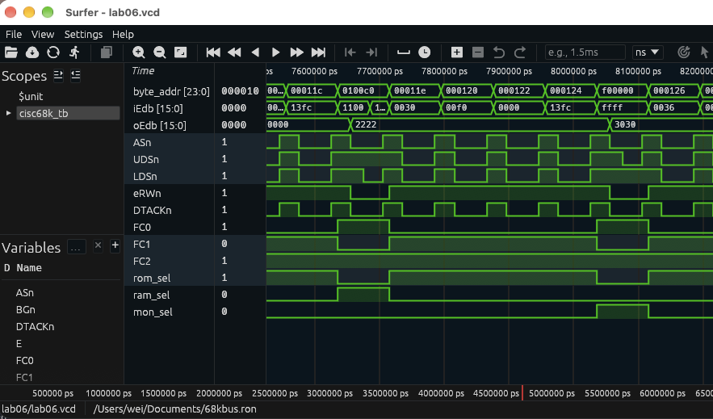

# cisc68k

Study the Motorola 68000 as a classic CISC architecture using a cycle-visible RTL environment.

The goal is architectural understanding: programming model, instruction encoding, addressing modes, calls, exceptions, interrupts, and the external bus. Mackerel-F + fx68k provide the reference system; RTL internals are not the subject unless needed to answer an architectural question.

## Current Status

**Complete — 2026-10-14.**

Labs 01–11 completed the standalone 68000 survey. After finishing the RV32I/PicoRV32 survey, [Lab12](labs/lab12/README.md) returned to the project for the final evidence-based CISC-vs-RISC comparison.

## Roadmap

1. Programming model — D0-D7, A0-A7, PC, SR, operand sizes
2. Instruction encoding — variable-length opcodes and extension words
3. Addressing modes — direct, indirect, indexed, PC-relative, immediate
4. Calls and stack — JSR/BSR/RTS, LINK/UNLK, ABI basics
5. Condition codes and control flow
6. Exceptions, vectors, supervisor/user mode
7. Interrupts and interrupt acknowledge
8. External bus — AS, UDS/LDS, R/W, DTACK, BERR, FC
9. Memory-mapped I/O and simple survey peripherals
10. C compiler/ABI examples
11. Concrete CISC vs RISC comparison with RV32I/PicoRV32

## Docs

- [Mission and scope](docs/mission-scope.md)
- [Survey roadmap](docs/roadmap.md)
- [Reference RTL environment](docs/environment.md)
- [macOS toolchain build](docs/macos-toolchain.md)
- [Simulation checkpoint](docs/simulation-checkpoint.md)
- [Verilator cheat sheet](docs/verilator-cheatsheet.md)
- [Surfer cheat sheet](docs/surfer-cheatsheet.md)
- [68000 I/O signals cheat sheet](docs/68000-io-signals-cheatsheet.md)
- [68000 assembly tutorial](docs/asm-tutorial.md)
- [References](docs/references.md)

## Credits

This project builds on the work of:

- [fx68k](https://github.com/ijor/fx68k) by Jorge Cwik — a cycle-accurate SystemVerilog 68000 core used as the CPU reference.
- [Mackerel-68k](https://github.com/crmaykish/mackerel-68k) by Colin Maykish — especially Mackerel-F, which provides a valuable working reference for fx68k integration, memory mapping, UART, timer, interrupts, firmware, and toolchain setup.
- ChatGPT by OpenAI — used as a study partner for architecture planning, debugging, experiment design, documentation, and keeping the survey focused on architectural understanding rather than turning into a retro-computer project.

All credit for the original upstream RTL and software remains with their respective authors and licenses.
